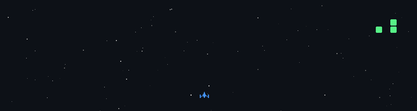

  

<h1 align="center">Talha Uğurlu</h1>

  <b>SOFTWARE</b> &nbsp;•&nbsp; <b>DATA</b> &nbsp;•&nbsp; <b>INTERACTIVE WORLDS</b> 
  Management Information Systems · Trabzon University · Türkiye

  
  
  
  

---

### 01 / PROFILE

**MIS student. Developer in progress. Creative thinker.**

Interested in practical software, data systems, game development and narrative-driven digital experiences.

> **Building useful systems and believable worlds.**

### 02 / TECH & CREATIVE TOOLS

  
  
  
  

  
  
  
  

Core learning: Python · SQL · OOP · Database Systems | Exploring: Game Engines · 3D · AI

---

### 03 / SELECTED WORK

#### 01 — OtoAkış

**Şaseci Onur Usta** &nbsp;·&nbsp; 

`Operations` · `Workflow` · `Automation`

#### 02 — Vargroup

*Working title* &nbsp;·&nbsp; 

`Finance` · `Python` · `Desktop Systems`

#### 03 — Kan ve Şöhret

*Creative universe* &nbsp;·&nbsp; 

`Worldbuilding` · `Narrative` · `Interactive Media`

Selected concepts and private initiatives. Technical details and unreleased materials are not public.

---

### 04 / ARCADE MODE

MY CONTRIBUTIONS, REIMAGINED AS A SPACE SHOOTER

  

Animated contribution visualization · Powered by <a href="https://github.com/czl9707/gh-space-shooter">gh-space-shooter</a>

---

  <b>Research &nbsp;·&nbsp; Design &nbsp;·&nbsp; Build &nbsp;·&nbsp; Improve</b> 
  © Talha Uğurlu | Titanium Project Arts

