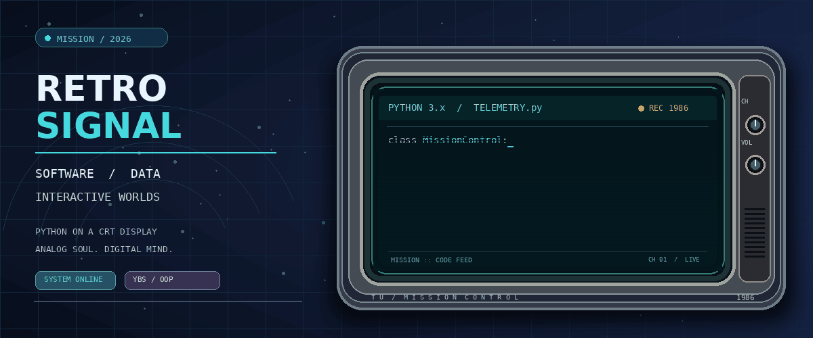

  

<h1 align="center">Talha Uğurlu</h1>

  <strong>Yazılım • Veri • Etkileşimli Dünyalar</strong> 
  Yönetim Bilişim Sistemleri Öğrencisi • Trabzon Üniversitesi • Türkiye

  
  
  
  

  
  
  
  
  
  

---

## 📺 Python Animasyonu

  

Retro CRT tarzında Python kodu animasyonu. Profilin görsel karakterini desteklemek amacıyla eklenmiştir.

---

## 👤 Hakkımda

Merhaba, ben **Talha Uğurlu**.  
Trabzon Üniversitesi'nde **Yönetim Bilişim Sistemleri** eğitimi alıyorum ve özellikle **yazılım geliştirme**, **veri odaklı düşünme**, **oyun sistemleri**, **yaratıcı teknoloji** ve **anlatı tasarımı** ile ilgileniyorum.

Teknik üretim ile yaratıcı düşünceyi aynı çizgide buluşturmayı seviyorum.  
Benim için iyi bir proje yalnızca çalışan bir sistem değil; aynı zamanda **düzenli**, **anlamlı**, **geliştirilebilir** ve **hatırlanabilir** bir yapı olmalıdır.

### İlgi alanlarım

- 💻 Yazılım geliştirme
- 🗃️ Veri sistemleri ve veritabanı mantığı
- 🎮 Oyun sistemleri ve etkileşimli deneyimler
- 🤖 Yapay zekâ destekli iş akışları
- 📚 Hikâye anlatımı, tarih ve anlatı tasarımı

### Çalışma yaklaşımım

- Yapısal düşünmeyi önemsiyorum
- Teknik detaylarda düzen ve açıklık arıyorum
- Öğrendiğim konuları proje mantığıyla oturtmaya çalışıyorum
- Uzun vadeli üretim alanları oluşturmayı hedefliyorum

> **Amaç:** Faydalı sistemler ve inandırıcı dijital dünyalar üretmek.

---

## 🎯 Misyon Odak Noktası

Şu anda ağırlıklı olarak aşağıdaki alanlara odaklanıyorum:

- 🐍 Python ve Nesne Yönelimli Programlama
- 🗄️ SQL ve veritabanı mantığı
- 🧱 Uygulamalı yazılım geliştirme
- 🎮 Etkileşimli sistemler ve oyun tasarımı
- 🤖 Yapay zekâ destekli iş akışları
- 🧠 Analitik düşünme ve sistem kurma becerisi

### Güncel öğrenme başlıkları

- Python temelleri ve OOP
- SQL sorgulama ve veri modeli mantığı
- Git ve GitHub ile sürüm kontrolü
- Küçük ölçekli uygulama geliştirme mantığı
- Yaratıcı teknoloji ve dijital üretim süreçleri

---

## 🛠️ Teknoloji Altyapısı

  

  
  
  
  

### Temel çalışma alanları

- **Python** — temel yazılım geliştirme, OOP, küçük ölçekli uygulamalar
- **SQL** — sorgulama, tablo mantığı, veri organizasyonu
- **Git / GitHub** — sürüm kontrolü ve proje arşivleme
- **VS Code** — aktif geliştirme ortamı
- **Blender / Unity / Unreal Engine** — yaratıcı teknoloji ve etkileşimli sistemler için keşif alanları

### İlgi duyduğum teknik eksen

- Veri sistemleri
- Uygulama mantığı
- Etkileşim tasarımı
- Oyun sistemleri
- Yapay zekâ destekli üretim
- Dijital anlatı ve deneyim kurgusu

---

## 📁 Seçilmiş Çalışmalar

| Proje | Tanım | Anahtar Kelimeler | Durum |
| :--- | :--- | :--- | :--- |
| **[YBS201 — OOP Ders Kayıtları](https://github.com/talhaugurlu/YBS201-OOP-Ders-Kayitlari)** | Python OOP ders çalışmalarımı ve uygulama örneklerini topladığım kişisel arşiv | `Python` `Classes` `Methods` |  |
| **OtoAkış** | Operasyon mantığı ve iş akışı temelli özel proje fikri | `Operations` `Workflow` `Automation` |  |
| **Vargroup** *(çalışma başlığı)* | Finans odaklı masaüstü yazılım yönünde gelişen erken aşama fikir | `Finance` `Python` `Desktop Systems` |  |
| **Kan ve Şöhret** | Uzun vadeli yaratıcı evren ve anlatı odaklı proje alanı | `Worldbuilding` `Narrative` `Interactive Media` |  |

Seçilmiş çalışmalar sınırlı kamuya açık bilgiyle sunulmaktadır. Bazı projeler erken aşamadadır veya özel tutulmaktadır.

---

## 📊 GitHub Analizleri

  
  

  

  

Buradaki analiz kartları üçüncü taraf servisler tarafından sağlanmaktadır. Zaman zaman yüklenmemesi normaldir. Dil grafiği, beceri seviyesini değil depo içeriğindeki dil dağılımını yansıtır.

---

## 🧭 Yaratıcı Yönelim

Teknik alanların yanında; **tarih araştırması**, **edebiyat**, **hikâye anlatımı**, **kurgu üretimi** ve **dijital atmosfer tasarımı** ile de yakından ilgileniyorum.

Benim için teknoloji yalnızca araç değildir; aynı zamanda fikir üretme, sistem tasarlama ve deneyim kurma alanıdır.

**Titanium Project Arts**, yazılım, yaratıcı teknoloji, anlatı sistemleri ve bağımsız proje üretimi çizgisini bir araya getirmeyi hedefleyen uzun vadeli kimliğimdir.

### Bu çizgide önemsediğim kavramlar

- Yapı
- Atmosfer
- Tutarlılık
- İşlevsellik
- Geliştirilebilirlik
- Anlatısal derinlik

---

## 📬 Benimle İletişime Geçin

  <a href="https://www.linkedin.com/in/talha-u%C4%9Furlu-851062242/">LinkedIn</a>
  &nbsp;•&nbsp;
  <a href="https://medium.com/@talhaugurlu">Medium</a>
  &nbsp;•&nbsp;
  <a href="https://www.youtube.com/@titaniumprojectarts">Titanium Project Arts</a>
  &nbsp;•&nbsp;
  <a href="mailto:talhaugurlu930@gmail.com">E-posta</a>

---

  <strong>ARAŞTIR • TASARLA • GELİŞTİR • İYİLEŞTİR</strong> 
  Talha Uğurlu • Titanium Project Arts

